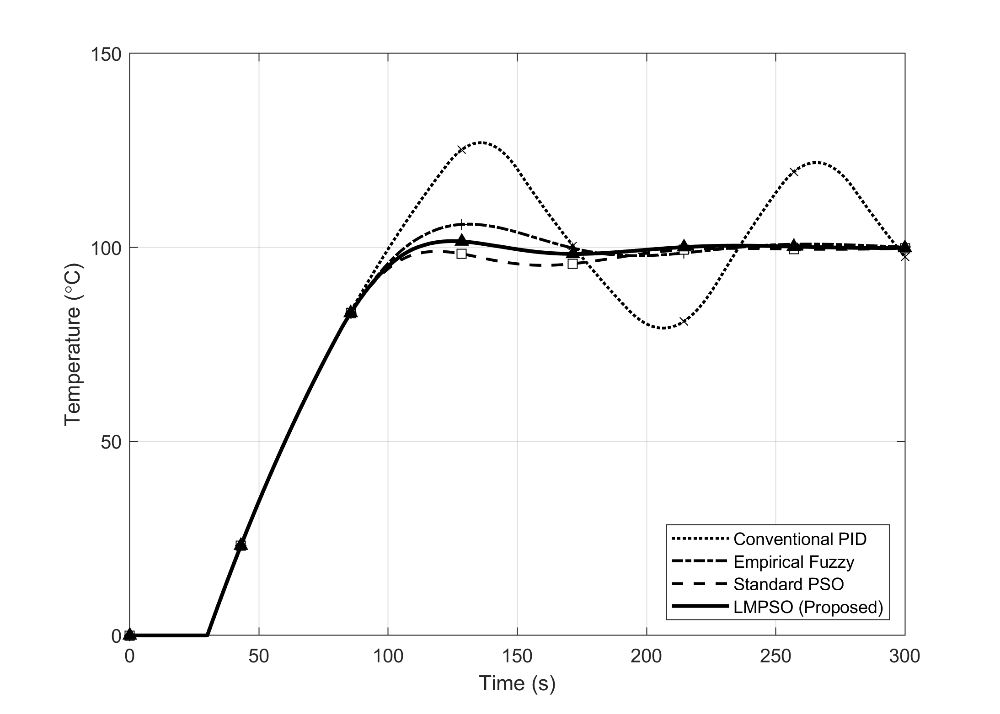
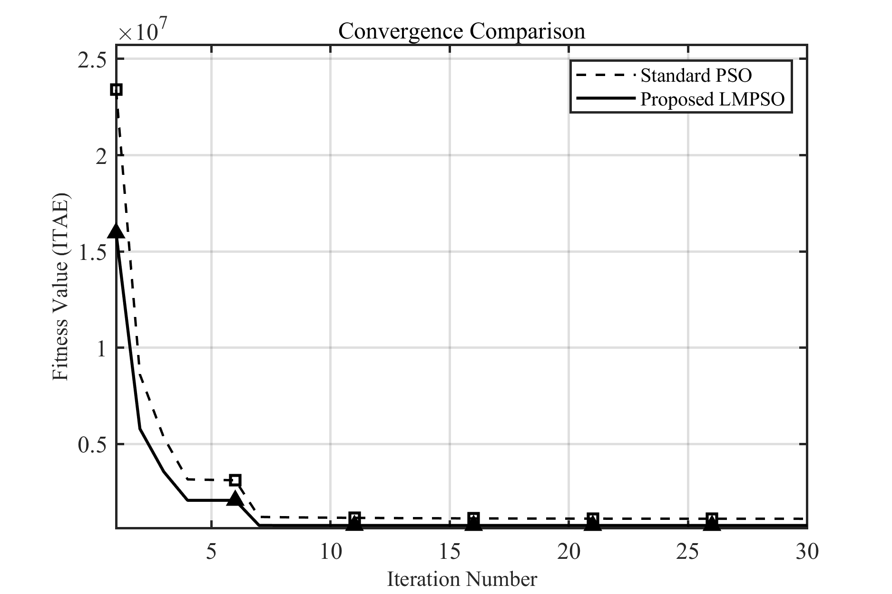
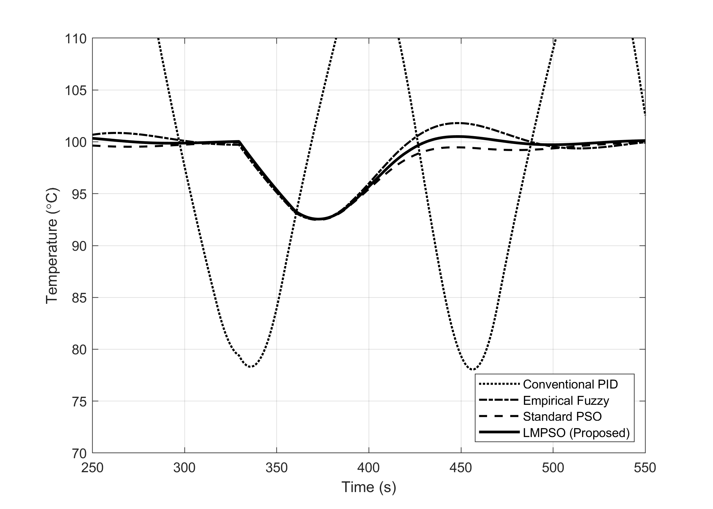
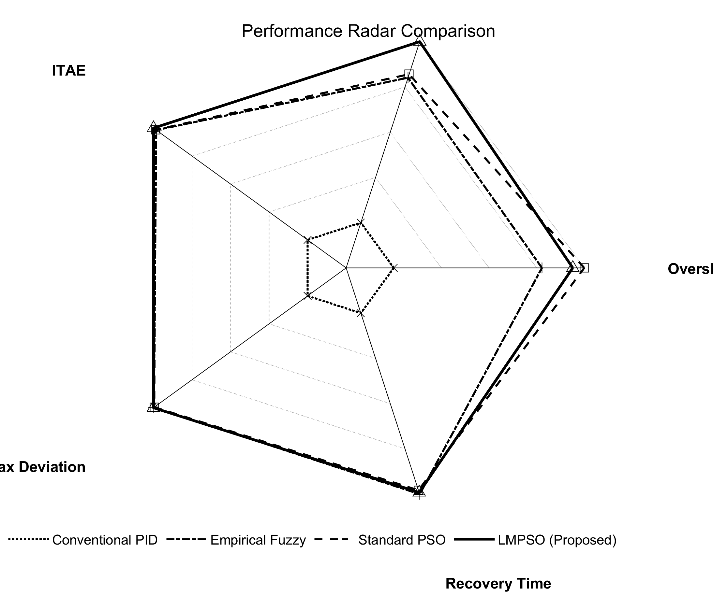

# Fuzzy-PID Temperature Control + IPSO

> EI 会议论文（**第一作者**）的仿真复现代码：针对温度系统**非线性、惯性滞后、参数整定困难**的问题，构建**模糊 PID** 控制结构，用**改进粒子群优化（IPSO，引入 Levy 飞行）**对控制参数做全局寻优，并以超调量、调节时间、稳态误差等指标完成对比评估。
> 配置了 **Levy 飞行的敏感性实验**与**消融对比实验**。



## 论文信息

| 项 | 内容 |
|---|---|
| 标题 | Research on Optimized Fuzzy PID Temperature Control Strategy Based on Improved Particle Swarm Optimization |
| 作者位次 | **第一作者** |
| 类型 | EI 会议论文（已录用） |
| 本项目内容 | 论文中的仿真复现代码、消融实验、敏感性分析、全部结果图 |

> **完整论文 PDF 未随本仓库公开**（版权归出版方）。

## 方法与实验

### 控制结构

```
   设定值 r(t) ──►┌──────┐   ┌────────┐   ┌──────────┐   ┌──────────┐
                 │ 误差 │──►│ 模糊推理│──►│  PID 参数 │──►│  被控对象 │──► y(t)
                 │  e   │   │  (FIS) │   │ 在线自整定 │   │ 温度模型  │
                 └──────┘   └────────┘   └──────────┘   └────┬─────┘
                     ▲                                        │
                     └────────────────────────────────────────┘
```

模糊推理根据误差 `e` 与误差变化率 `ec` 在线调整 PID 的 `Kp / Ki / Kd`，以适应温度系统的非线性与惯性滞后。

### IPSO 的改进：Levy 飞行

在标准 PSO 的位置更新中引入 **Levy 飞行**（重尾分布的长跳步），提升跳出局部最优的能力。Levy 飞行步长由 `src/Functions/levy_flight_function.m` 提供。

### 实验设计（本项目的亮点）

不是"跑通就算"，而是**分步验证改进是否有效**：

| 脚本 | 作用 |
|---|---|
| `src/Sensitivity_Analysis.m` | 敏感性分析：控制器参数扰动对性能指标的影响 |
| `src/step1_levy_sensitivity_test.m` | **第一步**：Levy 飞行参数（β 等）的敏感性测试 |
| `src/step2_comprehensive_comparison.m` | **第二步**：多控制器综合对比实验 |
| `src/Figure4_Fitness_Convergence_Curves.m` | 适应度收敛曲线绘制 |
| `src/generate_professional_figures.m` | 全套论文级图表批量生成（12.7 KB） |

**对比的控制器**（四组）：

| # | 控制器 | 说明 |
|---|---|---|
| 1 | 传统 PID | 基线，参数固定 |
| 2 | 模糊 PID | 模糊自整定，参数由经验给定 |
| 3 | PSO-FuzzyPID | 标准 PSO 优化模糊 PID 参数 |
| 4 | **IPSO-FuzzyPID** | 本文方法（PSO + Levy 飞行） |

## 结果

| 图 | 内容 |
|---|---|
| `Fig1_Model_Step` | 被控对象（一阶惯性纯滞后 FOPDT）阶跃响应 |
| `Fig2_Fuzzy_Surface` | 模糊推理输出曲面 |
| `Fig6_Convergence` / `Fig4_Sensitivity` | 适应度收敛与敏感性 |
| `Fig7_Step_Response` | 阶跃响应对比（超调量、调节时间） |
| `Fig8_Disturbance` | 扰动抑制性能 |
| `Fig9_Robustness` | 参数摄动下的鲁棒性 |
| `Fig10_Radar` / `Fig11_Performance_Radar` | **多指标雷达图**（综合性能对比） |
| `Fig11_RealTime_Scope` | 实时示波器响应 |





## 目录结构

```
.
├── src/                                  # ✅ 真正跑通并产出论文结果的实现
│   ├── Run_Complete_Simulation.m         # 一键运行全部流程（如需）
│   ├── step1_levy_sensitivity_test.m     # 第一步：Levy 飞行参数敏感性测试
│   ├── step2_comprehensive_comparison.m  # 第二步：四组控制器综合对比
│   ├── Sensitivity_Analysis.m            # 参数敏感性分析
│   ├── Figure4_Fitness_Convergence_Curves.m
│   ├── generate_professional_figures.m   # 论文级图表批量生成（12.7 KB）
│   ├── FuzzyPID_Temperature_Control.slx  # Simulink 模型
│   ├── Functions/                        # ★ 核心算法模块
│   │   ├── fuzzy_pid_simulator.m             # 模糊 PID 闭环仿真器
│   │   └── levy_flight_function.m            # Levy 飞行步长生成
│   ├── Scripts/                          # ★ 流程脚本
│   │   ├── plant_model.m                     # 被控对象（FOPDT 温度模型）
│   │   ├── create_fuzzy_controller.m         # 模糊推理系统（FIS）构建
│   │   ├── lmpso_optimization.m              # IPSO 参数寻优
│   │   └── run_comparison_experiments.m      # 对比实验
│   ├── FIS_Files/fuzzy_pid_controller.fis    # 模糊控制器定义文件
│   ├── Data/plant_parameters.mat             # 被控对象参数
│   ├── Results/                              # 寻优结果与敏感性数据
│   ├── Figures_Vector/                       # 矢量图（EPS / EMF，投稿用）
│   └── Final_Submission/                     # 最终提交版图表
├── src_scaffold/                         # ⚠️ 空壳模板（见下方说明）
└── figures/                              # 论文插图汇总（PNG + EMF，40 个文件）
```

### ⚠️ 关于 `src_scaffold/`

`src_scaffold/` 是我早期搭建的**目录骨架**（`Scripts/` + `Functions/` 分层），里面的文件是**空占位符**（内容为"请在此处编写代码"，每个 40–59 字节）。**真正跑通并产出论文结果的代码在 `src/` 下。**

保留它的原因是它记录了我"先规划模块划分、再逐个填充"的开发习惯——`src/` 与 `src_scaffold/` 的目录结构几乎一致，正说明骨架设计是有效的。但**如果你只关心能运行的代码，请直接看 `src/`**。

> 这是一个待改进项：计划把 `src_scaffold/` 删除，并把 `src/` 内散落的图表目录（`Figures_Vector/`、`Final_Submission/`）进一步归并到顶层 `figures/`。

## 快速开始

需要 MATLAB + **Fuzzy Logic Toolbox**（模糊控制器）+ **Simulink**：

```matlab
cd src
step1_levy_sensitivity_test        % 第一步：Levy 参数敏感性测试
step2_comprehensive_comparison     % 第二步：四组控制器综合对比
generate_professional_figures      % 批量生成论文图表
```

或直接在 Simulink 中打开 `FuzzyPID_Temperature_Control.slx` 交互式查看。

## 我负责的部分

**第一作者**。负责被控对象建模、模糊 PID 结构设计、IPSO 改进（Levy 飞行）与实现、敏感性/消融实验设计、结果分析与可视化、论文撰写与投稿全流程。

