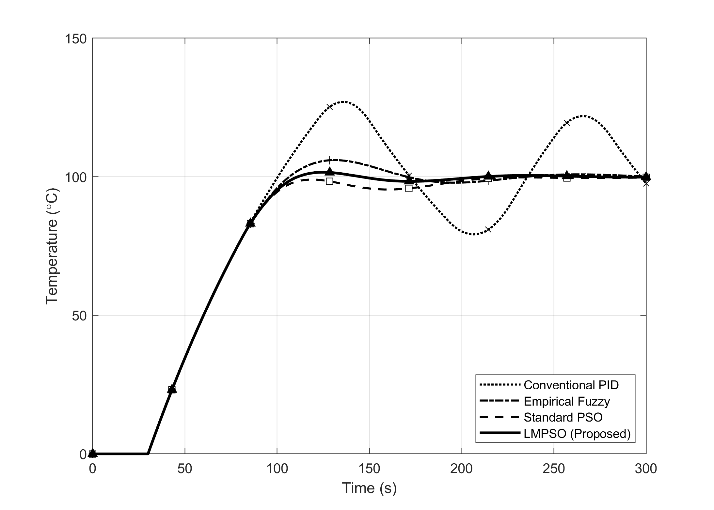
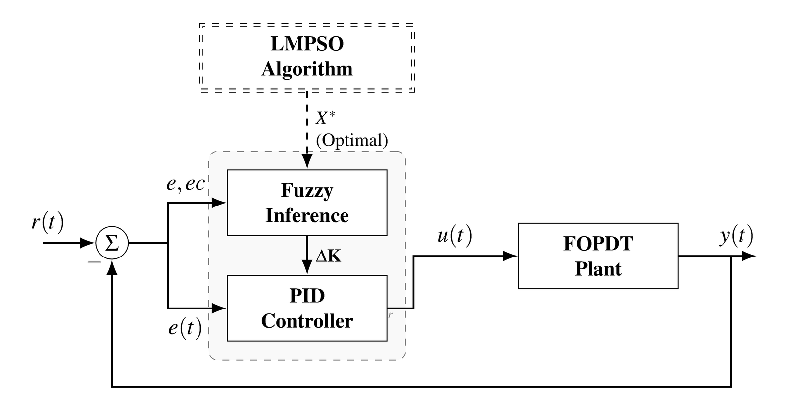
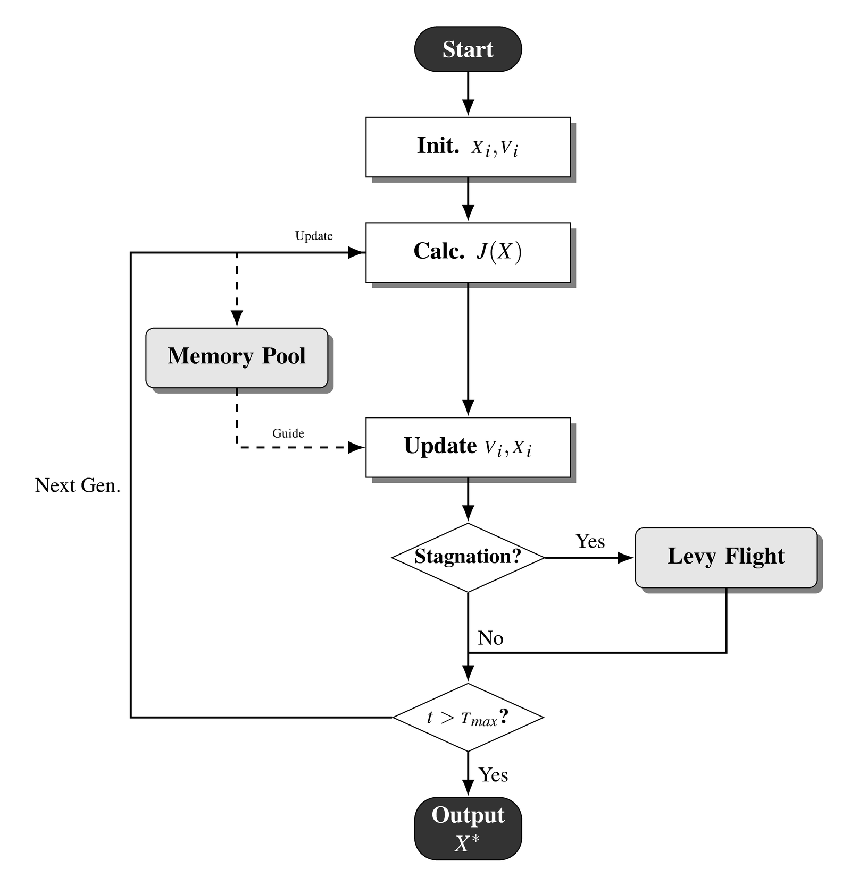
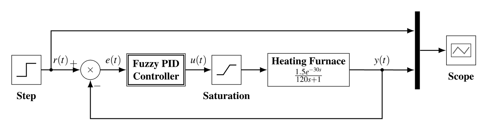
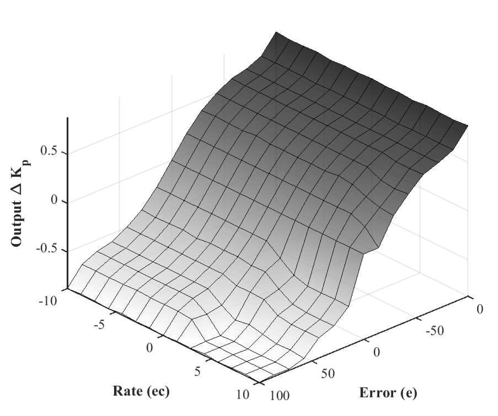
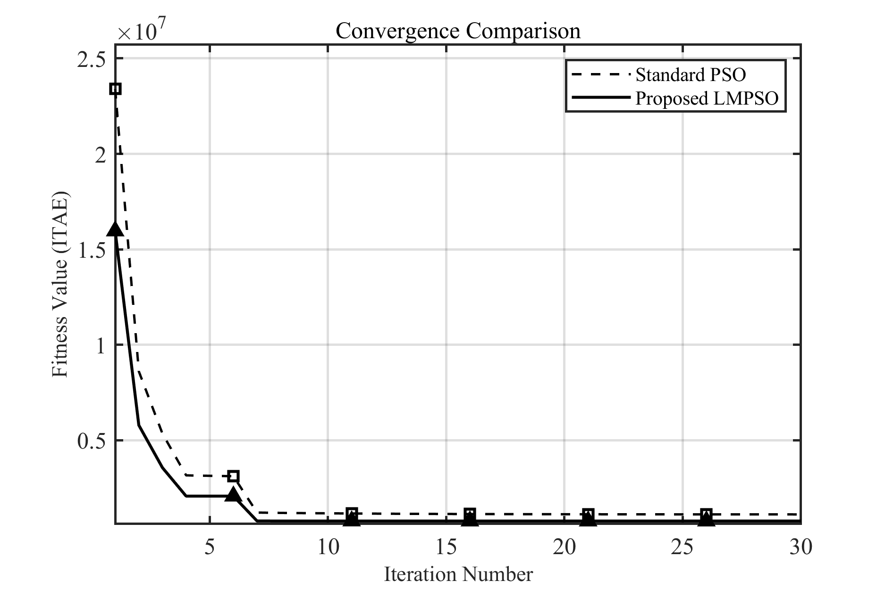
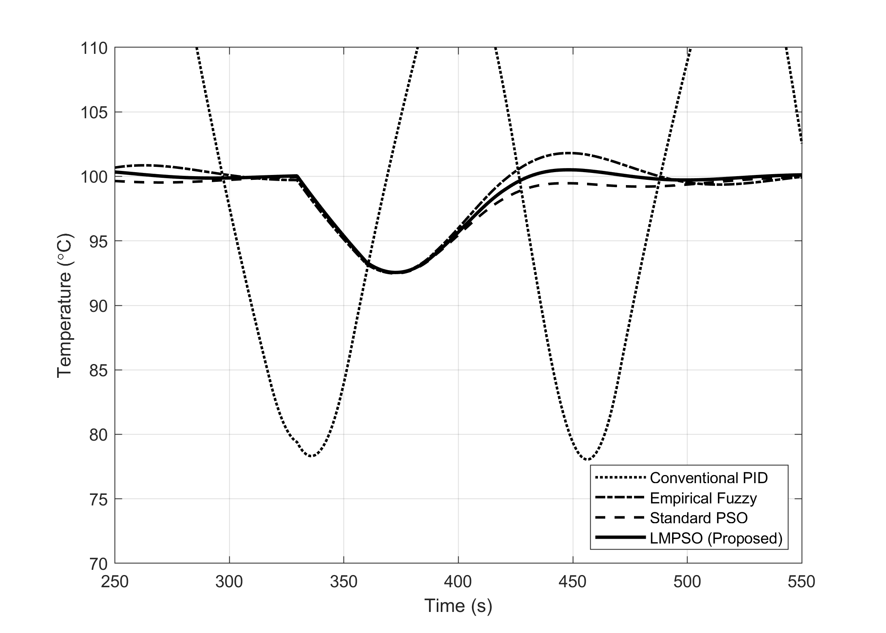
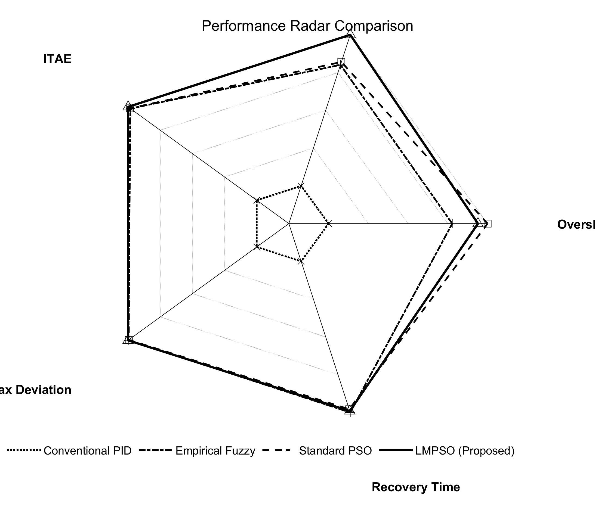

# Fuzzy-PID Temperature Control + IPSO (LMPSO)

> **EI 会议论文（第一作者）**仿真复现与实验归档：针对工业加热炉一阶惯性纯滞后模型（FOPDT，$G(s)=\frac{1.5e^{-30s}}{120s+1}$）存在的大滞后、非线性与参数整定困难问题，设计了 **模糊推理自整定 PID（Fuzzy-PID）** 控制架构，并提出融合 **Levy 飞行 + 记忆池引导的改进粒子群算法（LMPSO / IPSO）**对控制器量化/比例因子（`Ke, Kec, Kup, Kui, Kud`）进行全局寻优，完成收敛性、敏感性分析、负载抗扰与模型失配鲁棒性验证。



## 论文信息

| 项 | 内容 |
|---|---|
| **标题** | Research on Optimized Fuzzy PID Temperature Control Strategy Based on Improved Particle Swarm Optimization |
| **作者位次** | **第一作者**（EI 会议论文） |
| **被控对象** | 典型加热炉 FOPDT 温度对象：$G(s)=\frac{1.5e^{-30s}}{120s+1}$（30s 纯滞后，120s 惯性时间常数） |
| **仓库包含内容** | 完整 MATLAB 仿真脚本、Simulink 闭环模型（`.slx` / `.fis`）、优化/敏感性数据及全部论文图表 |

> 完整论文 PDF 因出版商版权协议未随公开仓库分发；所有算法源码、`.fis` 模糊规则与实验结果图已全部归档。

---

## 控制原理与优化机制

<table>
  <tr>
    <td width="55%" align="center">
      <br/>
      <sub><b>图 1：</b>LMPSO 参数整定 + 模糊推理 PID 闭环控制结构</sub>
    </td>
    <td width="45%" align="center">
      <br/>
      <sub><b>图 2：</b>引入停滞检测、记忆池引导与 Levy 飞行的优化流程</sub>
    </td>
  </tr>
</table>

- **模糊自整定（FIS）**：根据温度偏差 $e(t)$ 与偏差变化率 $ec(t)$ 在线修正 PID 增益偏移 $(\Delta K_p, \Delta K_i, \Delta K_d)$，模型见 [`src/FIS_Files/fuzzy_pid_controller.fis`](src/FIS_Files/fuzzy_pid_controller.fis)；
- **Levy 飞行跳出局部最优（LMPSO / IPSO）**：当粒子群陷入停滞时由 [`src/Functions/levy_flight_function.m`](src/Functions/levy_flight_function.m) 施加长尾随机扰动，在 ITAE 适应度指标下兼顾全局探索与快速收敛。

<details>
<summary>查看 Simulink 顶层闭环框图与模糊曲面图</summary>

| Simulink 闭环系统框图 | 模糊输出曲面（`ΔKp`） |
|---|---|
|  |  |

</details>

---

## 消融对比与鲁棒性实验

[`src/step2_comprehensive_comparison.m`](src/step2_comprehensive_comparison.m) 在统一闭环仿真器下对比 5 组方案：
1. `Conventional PID`（传统固定参数 PID）
2. `Empirical Fuzzy`（经验参数模糊 PID）
3. `Standard PSO`（标准粒子群整定模糊 PID）
4. `IPSO (Competitor)`（常规改进 PSO 对比方案）
5. **`LMPSO (Proposed)`**（本文 Levy 飞行 + 记忆池优化方案）

并在 **阶跃响应（Step）**、**负载扰动（Disturbance）**、**模型参数失配（Robustness）** 与 **Levy 指数 $\beta$ 敏感性（[`src/step1_levy_sensitivity_test.m`](src/step1_levy_sensitivity_test.m)）** 四类测试下完成评估：

| 适应度收敛曲线 | 负载扰动抑制 | 五维性能评估雷达图 |
|---|---|---|
|  |  |  |

---

## 目录结构

```text
fuzzy-pid-ipso-temperature-control/
├── README.md
├── figures/                                # 论文全部插图与架构图（Web 可预览 PNG，已清理冗余副本）
└── src/
    ├── Run_Complete_Simulation.m           # 一键串行运行建模 → 模糊设计 → 优化 → 对比全流程
    ├── step1_levy_sensitivity_test.m       # 第一步：Levy 飞行指数 β 敏感性分析
    ├── step2_comprehensive_comparison.m    # 第二步：5 种控制/优化方案多工况对比实验
    ├── Sensitivity_Analysis.m              # 控制器参数摄动敏感性分析
    ├── Figure4_Fitness_Convergence_Curves.m
    ├── generate_professional_figures.m     # 论文级黑彩图表批量导出脚本
    ├── FuzzyPID_Temperature_Control.slx    # Simulink 温度控制闭环仿真模型
    ├── Functions/                          # 闭环仿真器与 Levy 飞行核函数
    ├── Scripts/                            # 被控对象建模、FIS 构建、优化与实验脚本
    ├── FIS_Files/                          # fuzzy_pid_controller.fis 模糊规则文件
    ├── Data/                               # plant_parameters.mat 被控对象参数
    ├── Results/                            # optimal_controller_params.mat & sensitivity_data.mat
    └── Figures_Vector/                     # 投稿用原始 EPS/EMF 矢量源图
```

---

## 快速复现

需要 **MATLAB**（含 **Fuzzy Logic Toolbox** 与 **Simulink**）：

```matlab
cd src
Run_Complete_Simulation            % 全流程运行
% 或分步复现：
step1_levy_sensitivity_test        % 1. Levy 参数敏感性实验
step2_comprehensive_comparison     % 2. 多控制器综合对比与雷达图
generate_professional_figures      % 3. 批量导出论文图
```

## 个人职责

**第一作者**。独立完成 FOPDT 被控对象建模、模糊推理 PID 结构设计、LMPSO（Levy 飞行 + 记忆池）优化算法编写、消融/敏感性/鲁棒性对比实验、Simulink 模型搭建以及 EI 会议论文撰写与审稿修回实验。
